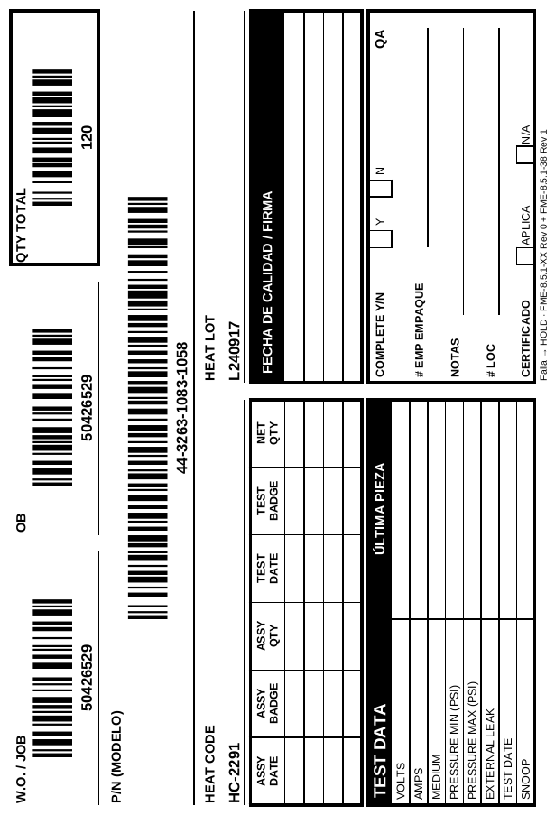

# Etiqueta ORDEN OPERADOR con Code 128 (Excel)

`Etiqueta_Orden_Operador_Code128_v2_vertical.xlsm` imprime la etiqueta 4 x 6 in de la
**ESTAMPA ÚNICA / ORDEN OPERADOR** con código de barras en:

| Campo         | Código de barras | Texto legible |
|---------------|------------------|---------------|
| W.O. / JOB    | sí               | sí            |
| OB            | sí               | sí            |
| QTY TOTAL     | sí               | sí            |
| P/N (MODELO)  | sí               | sí            |
| HEAT CODE / HEAT LOT | no (opcional, texto) | sí |

Simbología: **Code 128 Auto** (usa los subconjuntos B y C según el dato) con
**dígito verificador módulo 103**, igual que en Label Matrix.



## Cómo sale en el rollo 4 x 6

La etiqueta ya viene **girada dentro del Excel**, en la misma posición que la
plantilla ORDEN OPERADOR de Label Matrix: QTY TOTAL arriba a la izquierda,
OB al centro, W.O./JOB abajo, TEST DATA abajo a la derecha. Se imprime en
**vertical** a tamaño completo (3.9 x 5.9 in sobre la etiqueta de 4 x 6), así
el driver de la Zebra no tiene que girar ni encoger nada.

En la Zebra deja la orientación en **Vertical** (no Horizontal). Si alguna vez
sale de cabeza (180°), cámbialo en *Preferencias de impresión > Opciones >
Orientación* a **Vertical 180°**; no hace falta tocar el Excel.

### Si sale chica y derecha arriba de la etiqueta

Eso es la versión anterior (horizontal). Revisa que abriste
**`..._v2_vertical.xlsm`**: la barra azul de arriba dice **v2 (vertical)** y la
etiqueta de la izquierda tiene los textos de lado. En **Vista previa** la
etiqueta debe verse de pie, llenando la hoja. Si la vista previa se ve bien y
aun así sale chica, revisa en la Zebra el tamaño 4.00 x 6.00 in y la
orientación Vertical.

## Instalación (una vez por PC)

1. **Fuente**: instala la fuente Code 128 en cada PC que imprima. El archivo
   viene listo para **Libre Barcode 128** (Google Fonts, la que usa
   `barcode128.bas`). Si tu fuente tiene otro nombre, escríbelo en
   **CONFIG > Fuente de código de barras** tal como aparece en la lista de
   fuentes de Excel y presiona **Aplicar fuente**.
   - Fuente "Code 128" de grandzebu (usa Ñ / Ò / Ó): en CONFIG elige el mapeo
     **GRANDZEBU (Code 128)**.
   - Libre Barcode 128 o IDAutomation (usan Ì / Í / Î): mapeo
     **LIBRE / IDAUTOMATION** (el de fábrica).
   - En **CONFIG > PRUEBA** se ve un código de ejemplo: si salen letras en lugar
     de barras, la fuente no está instalada o el nombre no coincide.
2. **Macros**: si Excel dice que bloqueó las macros, cierra el archivo, clic
   derecho > *Propiedades* > marca **Desbloquear** > *Aceptar*, ábrelo y
   presiona **Habilitar contenido**.
3. **Impresora Zebra ZT230 (203 dpi)**: en *Preferencias de impresión* pon el
   tamaño de etiqueta **4.00 x 6.00 in** y orientación **Vertical**. La hoja
   ETIQUETA ya está en vertical, con márgenes 0 y ajustada a 1 página. El botón
   **Elegir impresora** abre el diálogo de Windows.

## Uso diario (hoja ETIQUETA)

1. Escribe o escanea **W.O. / JOB, OB, QTY TOTAL y P/N**. HEAT CODE y HEAT LOT
   son opcionales (si se dejan vacíos queda la línea para escribir a mano).
2. Revisa la etiqueta de la izquierda: es exactamente lo que se imprime, en
   la misma posición que Label Matrix.
3. Pon las **COPIAS** y presiona **IMPRIMIR**.
4. Escanea la etiqueta impresa en la columna **PRUEBA**: el ESTADO debe decir
   **OK**. Esto confirma el código y su dígito verificador.

El ESTADO también avisa:

- `CARÁCTER NO VÁLIDO`: Code 128 no acepta acentos ni Ñ.
- `NO COINCIDE`: lo escaneado no es igual a lo capturado.
- `HABILITA MACROS`: las macros están desactivadas y no se puede generar el código.

**Varias órdenes**: en la hoja **LISTA** pon una orden por fila y presiona
**IMPRIMIR LISTA**. Imprime las filas cuyo ESTADO no dice `IMPRESO` y les pone
fecha y hora; para reimprimir una fila borra su ESTADO.

## Tamaño del código

Con la fuente a **35.5 pt**, cada barra delgada mide **3 puntos** de la Zebra
(0.015 in), igual de nítido que un código nativo de 3 dots. Un JOB de 8
dígitos mide 1.2 in y un P/N como `44-3263-1083-1058` mide 3.1 in. Un P/N muy
largo se reduce solo para caber en la etiqueta (*Reducir hasta ajustar*).

## Fórmulas disponibles

Las funciones están en el módulo `ModCode128` y se pueden usar en cualquier
celda del libro:

- `=CODE128(A1)` → texto codificado; aplica la fuente de barras a esa celda.
- `=CODE128(A1, cfgMapeo)` → igual, con el mapeo elegido en CONFIG.
- `=CODE128_CHECK(A1)` → valor del dígito verificador mod 103 (0 a 102).

## Archivos

| Ruta | Qué es |
|------|--------|
| `Etiqueta_Orden_Operador_Code128_v2_vertical.xlsm` | El libro listo para usar |
| `vba/ModCode128.bas` | Codificador Code 128 Auto + verificador mod 103 |
| `vba/ModImpresion.bas` | Botones: imprimir, lista, limpiar, fuente, impresora |
| `vba/ThisWorkbook.cls` | Recalcula los códigos al abrir |
| `tools/build_xlsm.py` | Genera el `.xlsm` (diseño de la etiqueta y hojas) |
| `tools/vba_project.py` | Genera el `vbaProject.bin` desde los `.bas` |
| `tools/code128.py` | El mismo codificador en Python (pruebas) |
| `tools/test_code128.py` | Pruebas: verificador y lectura de los códigos |

Para cambiar el diseño o las macros y regenerar el libro:

```bash
pip install xlsxwriter
python3 tools/build_xlsm.py
python3 tools/test_code128.py ruta/LibreBarcode128-Regular.ttf   # opcional: pillow + zxing-cpp
```

También puedes editar las macros directo en Excel (Alt + F11); en ese caso
copia el cambio al `.bas` correspondiente para no perderlo al regenerar.

## Cómo se verificó

- Las macros se cargaron y ejecutaron en LibreOffice: `CODE128` dio el mismo
  resultado que `tools/code128.py` en 23 casos (numéricos, alfanuméricos,
  corridas pares e impares, símbolos, espacios, Ñ/acentos rechazados y mapeo
  GRANDZEBU). El ESTADO y el botón Limpiar funcionaron.
- La etiqueta girada se dibujó a 203 dpi con Libre Barcode 128 y los 4
  códigos (JOB, OB, QTY, P/N) se leyeron con un decodificador (zxing) con
  verificador válido. Todas las barras miden 3, 6, 9 o 12 puntos exactos.
- 32 textos que cubren los 105 valores de Code 128 que usa el codificador se
  dibujaron y decodificaron correctamente.
- Falta probarlo en Excel con la Zebra real: imprime una etiqueta y escanéala
  en la columna PRUEBA antes de usarlo en producción.
